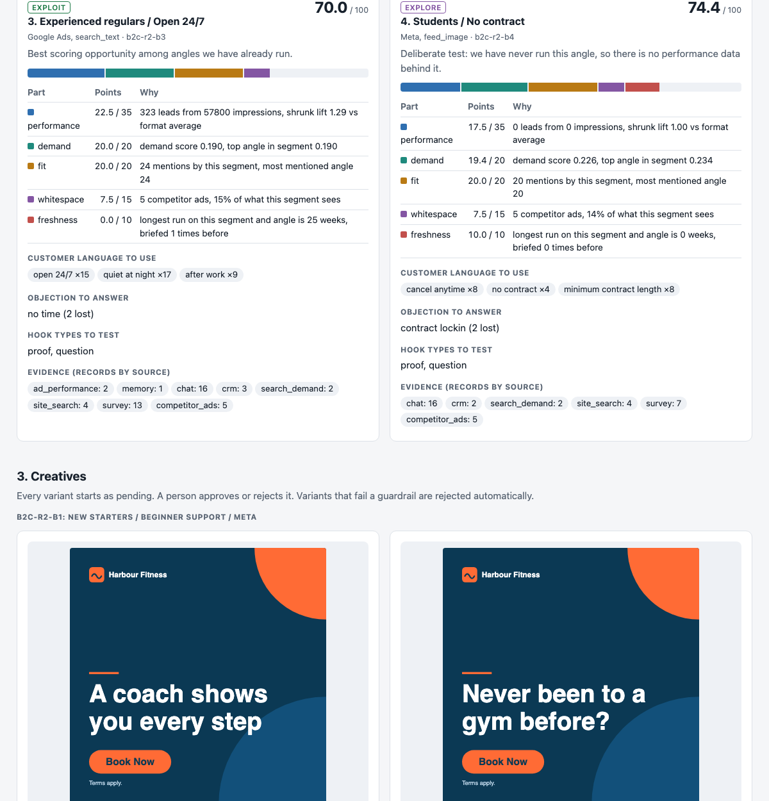
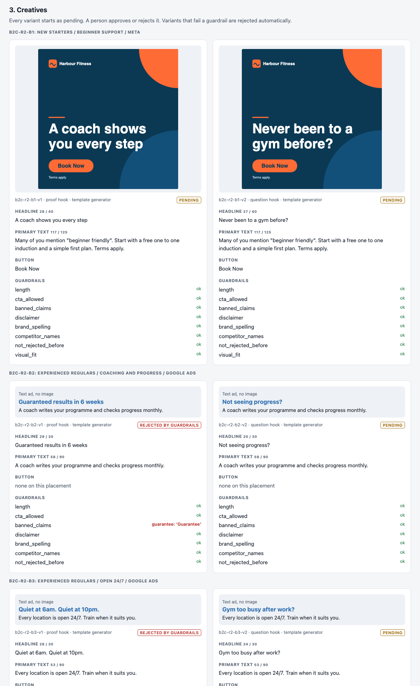
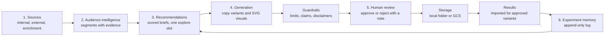

# audience-to-creative

An end-to-end example pipeline: audience intelligence, then creative recommendations, then generated ad creative, with a human approval step and a memory of what was tried.

**All data here is synthetic.** The businesses ("Harbour Fitness" and "Harbour Fitness Corporate") and their competitors are invented. Any resemblance to a real company is a coincidence. This is an example of an approach, not a production system. It follows the shape of systems I build in my work, rebuilt from scratch on invented data.



*The gallery page for the B2C example: segments built from the data, then briefs ranked by a score you can read part by part.*



*Further down the same page: the generated variants. Each waits for a person to approve it. One was rejected automatically for promising guaranteed results.*

**The full design behind this example is in [docs/methodology.md](docs/methodology.md):** twelve stages on Google Cloud, including vision tagging, image and video generation, and the review and release steps, with a label on each stage saying whether it runs in production at my job, ran as a pilot, exists in this repository, or is designed only.

**Where the creative attributes come from:** the pipeline assumes each ad already has tags such as angle, format and hook type. The step that produces tags from the images is in a separate repository, [creative-tagger](https://github.com/mert-atalay/creative-tagger).

## What it does



Nothing is published anywhere. The pipeline stops at a list of pending variants and a gallery page for a person to review.

## Run it

You need Python 3.12 or newer and [uv](https://docs.astral.sh/uv/).

```bash
uv sync
uv run python -m pipeline demo
open out/b2c/gallery.html   # and out/b2b/gallery.html
```

The demo runs the whole loop for both profiles: run, review, import results, run again. The review in the demo is scripted from `data/demo/<profile>/review_decisions.json` so it can run unattended. In real use a person decides.

Run the tests with `uv run pytest`.

If you only want to look, the output of the demo is committed under `examples/`. A test fails if those files are stale.

### Commands

| Command | What it does |
| --- | --- |
| `python -m pipeline run --profile b2c` | Run all stages for one profile (`b2c` or `b2b`). |
| `python -m pipeline review --profile b2c` | Walk through pending variants and approve or reject each with a note. |
| `python -m pipeline review --profile b2c --list` | List variants and their status. |
| `python -m pipeline review --profile b2c --approve ID --note "..."` | Decide one variant. `--reject` works the same way. |
| `python -m pipeline results --profile b2c --file results.json` | Import results for approved variants into memory. |
| `python -m pipeline demo` | Everything above, for both profiles, with fixed timestamps. |
| `python -m pipeline fixtures` | Regenerate the bundled synthetic data from its seed. |

Every command takes `--out` (a folder, default `out`, or a `gs://` url). Prefix commands with `uv run`.

## The stages

Each stage is one small module with one input and one output file under `out/<profile>/`.

| Stage | Module | Reads | Writes |
| --- | --- | --- | --- |
| 1. Sources | `pipeline/sources.py` | `config/sources.yaml`, `data/fixtures/` | `sources.json` |
| 2. Audience intelligence | `pipeline/audience.py` | `sources.json` | `audience.json` |
| 3. Recommendations | `pipeline/recommend.py` | `audience.json`, ad history, memory | `briefs.json` |
| 4. Generation and guardrails | `pipeline/generate.py`, `guardrails.py`, `svg.py` | `briefs.json` | `variants.json`, `creatives/*.svg` |
| 5. Review and storage | `pipeline/review.py`, `storage.py`, `gallery.py` | `variants.json` | `variants.json`, `gallery.html` |
| 6. Experiment memory | `pipeline/memory.py` | everything above, result files | `memory.jsonl` |

### 1. Sources

Every source sits behind one interface (`Source.load()` returns a list of records with an `id`). There are two modes.

- **fixture** (default): bundled synthetic data in `data/fixtures/`, written by a seeded generator (`pipeline/fixtures.py`, inputs in `config/fixture_seed.yaml`). Same seed, same files.
- **live**: documented in `config/sources.yaml` but not implemented. Setting `mode: live` raises an error that names the planned connector and the credential it would need.

The sources are:

- Internal: CRM leads and customers with stage and lost reason, ad performance per creative (impressions, clicks, leads, spend, plus angle, format and hook type), on-site search terms, on-site chat questions, survey free text.
- External: competitor ads shaped like a public ad library export (advertiser, start date, text, format), public review snippets, search demand by query.
- B2B enrichment: a firmographic lookup (industry, size band, region) keyed by company domain.

There is no scraper in this project and I do not plan to add one. Live collection should use official platform APIs or exports, and it should respect each site's terms. The config shape for a live source looks like this:

```yaml
competitor_ads:
  kind: external
  mode: live            # "fixture" uses the bundled synthetic data
  live:
    connector: ad_library_api_or_export
    auth_env: AD_LIBRARY_TOKEN
    notes: Use the official ad library API or its export. Do not scrape pages.
```

**No personal data.** The fixtures hold coarse attributes only: no names, emails, phone numbers or addresses. A test checks this. In the B2B path only companies are enriched, by domain. People are never enriched.

### 2. Audience intelligence

Segments are rules on CRM fields, defined in `config/profiles/<profile>.yaml`. The first rule that matches wins. For each segment `audience.json` holds:

- size and value signals (leads, customers, conversion rate, monthly value)
- motivations (survey answers tagged to an angle) and objections (chat questions and lost reasons)
- lost reasons from the CRM, and which angle speaks to each
- the phrases people use: two and three word phrases counted across survey, chat, search terms and reviews, with a small stop list
- channels
- what competitors say to this segment: the share of competitor ads per angle
- gaps: angles where demand is above an even share, competitors rarely use the angle, and we have run little or nothing on it

Text is tagged to an angle by keyword lists in the profile config. It is plain counting, with no model involved.

### 3. Recommendations

Every segment x angle x format combination gets a score out of 100. `briefs.json` holds the ranked briefs. Each brief has the segment, the angle, the customer language to use, the objection to answer, the format, the hook types to test, the score broken into its parts, and the evidence. The file also lists every scored combination under `ranking`, so you can see what was not chosen.

The run picks three "exploit" briefs: the best combinations among angles that have data, one per angle. It then adds one **explore** brief: a deliberate test of an angle that has never been run. That brief is labelled `"slot": "explore"` and says so in the gallery.

### 4. Creative generation

For each brief the generator writes one copy variant per hook type (headline, primary text, button), sized for the brief's placement. Placement specs live in `config/platforms.yaml`:

| Format | Placement | Headline | Primary text | Visual |
| --- | --- | --- | --- | --- |
| `feed_image` | Meta feed | 40 | 125 | 1080 x 1080 SVG |
| `story_image` | Meta stories | 40 | 125 | 1080 x 1920 SVG |
| `search_text` | Google responsive search ad | 30 | 90 | none, text only |
| `linkedin_image` | LinkedIn single image | 70 | 150 | 1200 x 627 SVG |

These limits are the commonly recommended lengths as I understand them. Check them against each platform's current documentation before relying on them.

Visuals are SVG files drawn from a brand template: brand colours, a generic font family, a simple shape as the logo, the headline and a button. Text is wrapped and sized to fit. If it cannot fit, the variant is rejected instead of drawn with overflow.

There are two generators behind one interface:

- **template** (default): deterministic copy from the angle templates in the profile config. Used in tests and CI. All committed examples come from this generator.
- **llm** (optional): asks Claude through the Anthropic API. See "Switching on the LLM generator".

### 5. Review and storage

Variants that pass the guardrails are written with status `pending`. A person approves or rejects each one with a note, using `python -m pipeline review`. Variants that fail a guardrail get status `rejected_by_guardrails` and cannot be approved.

`gallery.html` is one self-contained page: inline CSS, inline SVG, no scripts, no external requests. It follows the system light or dark setting and works at phone width. It shows the segments, the ranked briefs with their score breakdown and evidence counts, the creatives with status and guardrail results, and the memory log.

Outputs go through a storage interface with two backends: a local folder (default) and Google Cloud Storage.

### 6. Experiment memory

`memory.jsonl` is an append-only log. Each line is one event: a run, a brief (what and why, score parts, evidence counts), a variant (copy, status, guardrail failures), a review decision, or a result.

`python -m pipeline results` imports results for approved variants. Rows for variants that were not approved are skipped, and the command says why. The next run then uses the log in three ways:

1. Imported results count as performance data, next to the ad history.
2. An angle that has results is no longer "untried", so the explore slot moves to another angle.
3. A segment and angle that was briefed before loses some freshness, and a headline a reviewer rejected for a segment is not proposed to that segment again.

In the committed B2C example, run 1 tests the "beginner support" angle in the explore slot. The made-up results for it are strong, so run 2 ranks it first as a normal brief and moves the explore slot to "no contract". The numbers are invented. The example shows the mechanism, not a finding.

## What the score is made of

| Part | Weight | How it is computed |
| --- | --- | --- |
| performance | 35% | Leads per impression of our own creative for this segment, angle and format, compared with the average for the format. Shrunk towards the average (see below). |
| demand | 20% | Average of three shares for the angle: external search volume, on-site searches and anonymous chat questions, and this segment's own mentions. Relative to the top angle in the segment. |
| fit | 20% | How often this segment mentions the angle in surveys, chat and lost reasons. Relative to the segment's most mentioned angle. |
| whitespace | 15% | One minus the competitor share for the angle, relative to the most used angle. Crowded angles score lower. |
| freshness | 10% | One minus fatigue. Fatigue grows with the longest run of this segment and angle (26 weeks counts as full) and with each earlier brief for it in memory. |

Two rules stop small samples from winning:

- **Shrinkage.** Lift = (leads + 15) / (expected leads + 15), where expected leads is impressions times the format's average lead rate. With no data the lift is exactly 1.0. A combination needs real volume before its own rate outweighs the average.
- **Minimum volume.** Below 2,000 impressions a combination's own results are ignored and it scores as average.

The weights and thresholds are constants at the top of `pipeline/recommend.py`. They are my judgement calls. They are not fitted to anything.

## How evidence tracing works

Every insight carries an `evidence` list. Each entry names a source, the record ids behind the claim, and a count:

```json
{
 "reason": "too_expensive",
 "count": 5,
 "share": 0.357,
 "answered_by": "price_value",
 "evidence": [
  { "source": "crm", "ids": ["crm-0029", "crm-0068", "crm-0076", "crm-0087", "crm-0199"], "count": 5 }
 ]
}
```

`out/<profile>/sources.json` is a snapshot of every record used in the run, one record per line. To check a claim, search that file for the id. Evidence with source `memory` points at event ids in `memory.jsonl`. A test walks `audience.json` and `briefs.json` and fails if any id does not exist.

## Guardrails

Guardrails run on every variant, whichever generator wrote it. A variant that fails any rule is rejected with the reasons.

| Rule | What it checks |
| --- | --- |
| `length` | Each field is within the placement's character limit and not empty. |
| `cta_allowed` | The button is one the placement offers. Search ads have no button. |
| `banned_claims` | No guarantees, weight loss promises, medical claims or superlatives (B2C). No guarantees, unsupported percentages or medical claims (B2B). |
| `disclaimer` | A free offer needs "Terms apply." (B2C). A pilot offer needs "Pilot terms apply." (B2B). |
| `brand_spelling` | "Harbour Fitness" is written exactly that way. |
| `competitor_names` | No competitor is named. |
| `not_rejected_before` | A reviewer has not already rejected this headline for this segment. |
| `visual_fit` | The text fits the SVG template. Only for placements with a visual. |

The rules are regular expressions and lists in the profile config. One template headline in each profile breaks a rule on purpose ("Guaranteed results in 6 weeks", "Cuts staff turnover by 30%"), so the demo shows a rejection. Both are marked with a comment in the config.

## B2C and B2B

| | B2C: Harbour Fitness | B2B: Harbour Fitness Corporate |
| --- | --- | --- |
| A CRM row is | a prospective member, with coarse attributes only | a company, keyed by domain |
| Enrichment | none | industry, size band and region by company domain |
| Segments come from | plan interest and gym experience | industry and size band |
| Won stage | `member` | `customer` |
| Value signal | monthly membership price | seats quoted x price per seat |
| Angles | price, no contract, beginner support, 24/7, classes, coaching | wellbeing, hiring and retention, simple admin, access for every shift, per-seat pricing, usage reports |
| Placements | Meta feed, Meta stories, Google search | LinkedIn single image, Google search |
| Banned claims | guarantees, weight loss promises, medical claims, superlatives | guarantees, unsupported percentages, medical claims |
| Disclaimer rule | free offers | pilot offers |

Both profiles run through the same code. The differences are in `config/profiles/b2c.yaml` and `config/profiles/b2b.yaml`.

## Switching on the LLM generator

```bash
uv sync --extra llm
export ANTHROPIC_API_KEY=...
uv run python -m pipeline run --profile b2c --generator llm
```

- The model defaults to `claude-sonnet-5-5`. Change it with `PIPELINE_LLM_MODEL`.
- The request asks for JSON that matches a schema and opts in to the API's server-side refusal fallback. Set `PIPELINE_LLM_FALLBACK=0` to turn the fallback off.
- Without a key, or without the `anthropic` package, the run prints a warning and uses the template generator. If a call fails or the answer is unusable, that brief falls back to the template generator. Each variant records which generator wrote it.
- LLM output goes through the same guardrails and the same human review.

I have not run this path against the real API. It is covered by tests with a fake client, and I checked the call parameters against the SDK's method signatures (anthropic 2.13.0). No output in this repository was written by a model.

## Switching on Google Cloud Storage

```bash
uv sync --extra gcs
gcloud auth application-default login   # or set GOOGLE_APPLICATION_CREDENTIALS
uv run python -m pipeline run --profile b2c --out gs://my-bucket/some/prefix
```

`review` and `results` take the same `--out`. You can also set `PIPELINE_STORE`. The backend is covered by tests with a fake client, including a full pipeline run. I have not run it against a real bucket.

## Limits

- Segments are fixed rules. There is no clustering and no model. On real data the rules would need care and review.
- There are no real connectors. Live mode is a config shape and an error message. There is no scraping.
- The LLM path and the GCS path have not been exercised with real credentials.
- The score is a heuristic. The weights, the shrinkage strength and the thresholds are my choices. Nothing here is validated against real outcomes, and the synthetic data was written by a generator I shaped, so the example results prove nothing about any market.
- Performance uses leads per impression only. It ignores cost, lead quality and revenue. There is no significance testing.
- Angle tagging and phrase extraction are keyword matching and n-gram counting. They miss synonyms, typos, negation and anything not in the keyword lists. Some extracted phrases are clumsy.
- "What competitors say to this segment" is a guess from keywords in the ad text. An ad library export does not say who an ad targets.
- Reviews only feed the phrase counts. They are not used for sentiment.
- The SVG templates are simple: one layout, flat shapes, no photography. There is no image generation model. Text width is estimated from a character table with a safety margin, because no font file is bundled, so fitting is conservative and can be wrong for unusual fonts.
- The template generator writes one headline and one description for a search ad. Real responsive search ads take several of each.
- Platform character limits are hard-coded and may be out of date.
- `variants.json` holds the current run only. Decisions from earlier runs stay in the memory log, but you cannot review an old run's variants after a new run.
- The memory log is one file. On GCS an append is a read followed by a write, so it is not safe for two writers at once.
- The guardrails are pattern lists. They are a first filter for a human reviewer. They are not a legal or policy review.
- Results are imported from a JSON file keyed by variant id. There is no connection to an ad platform.

## Layout

```
config/            sources, platform specs, the two profiles, fixture seed
data/fixtures/     bundled synthetic source data (generated)
data/demo/         scripted review decisions and made-up results for the demo
pipeline/          the stages and the CLI
tests/             pytest suite
examples/          committed output of the demo (b2c and b2b)
docs/              screenshots used in this README
```

## License

MIT. See [LICENSE](LICENSE).
