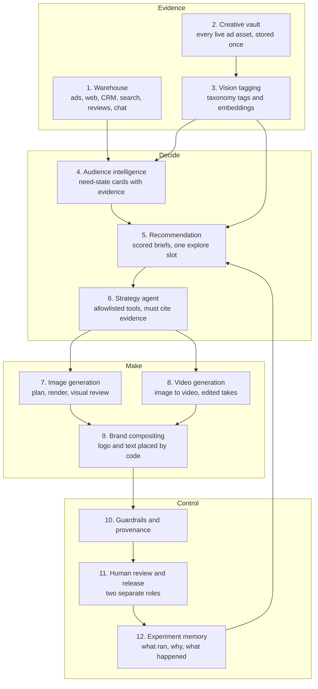

# Methodology: from audience evidence to creative, on Google Cloud

This page describes the full system this repository is a small model of. It is a reference design: the version I would build with a free hand. Parts of it run at my job, parts I have run as pilots, parts exist only in this repository, and parts are designed but not built. Every component below carries one of four labels, so nothing here claims more than is true.

| Label | Meaning |
| --- | --- |
| **Production** | Runs on a schedule at my job. |
| **Pilot** | I built it and ran it for real at my job, but it is not a routine process yet. |
| **This repo** | Implemented and tested in this repository, on invented data. |
| **Design** | Designed, not yet built. |

The system at my job is private. This page names no company, shares no data and no code from it, and describes the method in general terms.

## The loop

## Stage by stage

### 1. Warehouse. **Production**

Ad platforms, web analytics, search data, form submissions, CRM stages, chatbot topics and review themes load into BigQuery. Scheduled jobs refresh the models, and data tests fail the run when keys duplicate or totals stop matching the source. Reviews and chats are kept only as counted themes, never as raw text about a person.

Why it matters here: every later claim needs a number someone can trace to a query.

### 2. Creative vault. **Production**

Every live ad image is copied once into a private storage bucket, keyed by a content hash. Ad platforms rotate and delete assets; the vault means the picture a result belongs to can always be found again.

### 3. Vision tagging. **Production**, with one honest caveat

A vision model tags each stored creative against a fixed visual taxonomy: format, people and setting, text amount, offer, call to action, composition. A multimodal embedding is stored beside the tags so similar creatives can be found without relying on the tags alone.

Simple baseline models then check whether tags explain click-through rate, retraining weekly behind promotion gates. The caveat: the visual model has not passed its gate yet, so tags inform analysis but do not rank anything. That is the gate working as intended. Tags do not get to drive decisions until a hand-labelled calibration set shows the tagger agrees with people often enough.

### 4. Audience intelligence. **Pilot**, and **This repo**

Evidence from the warehouse and from outside sources (search demand, competitor messaging from official ad libraries and public pages, public statistics) is assembled into need-state cards: what a group of people is trying to get done, what triggers the search, what holds them back, and the words they use.

Two rules keep this from turning into invented personas:

- Each card is labelled as a supported or partial hypothesis, with the evidence ids behind it. Nothing is stated as fact about who a person is.
- Counts from different sources are never added together. A search volume and a form count measure different things.

For business customers the same method applies to companies. Enrichment is by company only: industry, size, region.

### 5. Recommendation. **This repo**

Candidate briefs are scored on five readable parts: past performance of the angle (shrunk toward the average when the sample is small), demand, fit with the segment's own language, whitespace left by competitors, and freshness. One slot is always an explore brief for an untried angle, labelled as a test.

At my job this step is a reasoned review, not a formula. The scored version here is how I would run it once enough history exists to check the weights against outcomes.

### 6. Strategy agent. **Pilot**

An agent drafts the brief. It runs on a short-lived machine with a small allowlist of tools and a frozen snapshot of evidence: named aggregate queries only, no raw customer data, and no ability to publish or change a campaign. Every claim in its output must cite a valid evidence id. A second model reviews the draft and returns pass or changes before a person sees it.

The brief has a fixed shape: need-state, trigger, tension, one message, three hooks (visual, spoken, on-screen), beats, visual direction, platform copy, call to action, and a statement of what result would prove the idea wrong.

### 7. Image generation. **Pilot**

Three steps in sequence: a planner turns the brief into a render plan, an image model renders once, and a visual reviewer looks at the actual image next to the brand rules. There is one generation per attempt and no silent retries, so cost and outcomes stay countable.

### 8. Video generation. **Pilot**, one production so far

Approved still images go to an image-to-video model with tight settings: short clips, restrictions on generating people, and negative prompts. Takes are then edited with text, logo and music layers, and the final file is decode-checked.

### 9. Brand compositing. **Pilot**, and **This repo**

Image models distort logos and misspell text. So the model never draws either. The logo and all words are placed afterwards by ordinary code from a template, and a small file beside each asset records where they went. In this repository the same idea produces the SVG visuals.

### 10. Guardrails and provenance. **Pilot**, and **This repo**

Before a person sees a variant, rules check length limits, banned claims, required disclaimers, brand spelling and competitor names. Each generated file is saved before review with a content hash, a record of the model and a hash of the prompt, and uploads refuse to overwrite an existing object. A status travels with the file, starting as an unapproved prototype.

### 11. Human review and release. **Pilot**, and **This repo**

A small web app, built and partly in use, handles upload, analysis, rights and visual review, and release. Review and release are separate roles, so the person who approves is never the person who ships. Nothing is published to an ad platform automatically. That is a choice, not a gap.

### 12. Experiment memory. **This repo**; **Design** at full scale

Every brief and variant is logged with its reason and evidence, then with its results. The next recommendation run reads that log, so a rejected headline is not proposed again and a winning angle earns more weight. At my job the tables for this exist and are still empty; this repository shows the loop closing on invented results.

## What I would add next. **Design**

- **A calibration set for the tagger:** a few dozen assets labelled by two people, with agreement measured before tags may influence ranking.
- **Holdout tests** for generated creative against the current best, sized before launch, so "better" means measured.
- **A propensity signal** from the warehouse to weight segments by likelihood to convert, behind the same promotion gates as the visual model.
- **Budget-aware prioritisation,** so briefs go first to places with room to grow.

## What this design deliberately leaves out

- Enriching or profiling individual people.
- Collecting data in ways a platform's terms do not allow. Official APIs, exports and public ad libraries only.
- Sensitive-trait targeting.
- Generated images of real people, and generated children.
- Automatic publishing.

## How this repository maps to it

| Design stage | In this repository |
| --- | --- |
| 1, 2 | Seeded fixture data in place of a warehouse and a vault |
| 3 | Creative attributes arrive already tagged in the fixtures |
| 4 | `pipeline/audience.py`, rule-based, with evidence ids |
| 5 | `pipeline/recommend.py` |
| 6 | Not modelled; briefs come straight from the scores |
| 7, 8 | Template visuals stand in for the image and video models |
| 9 | `pipeline/svg.py` |
| 10 | `pipeline/guardrails.py`, `pipeline/storage.py` |
| 11 | `pipeline/review.py` |
| 12 | `pipeline/memory.py` |
